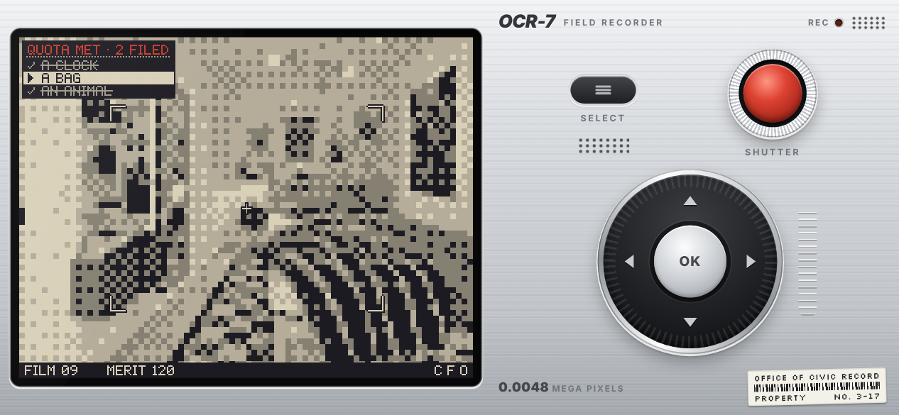
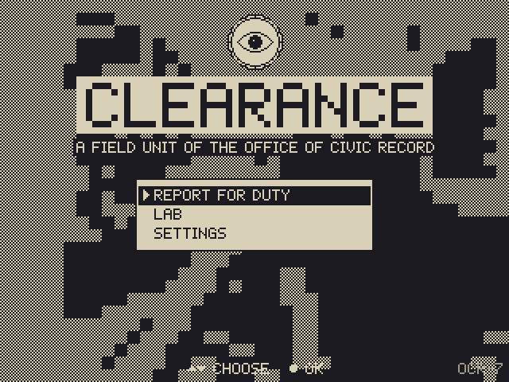
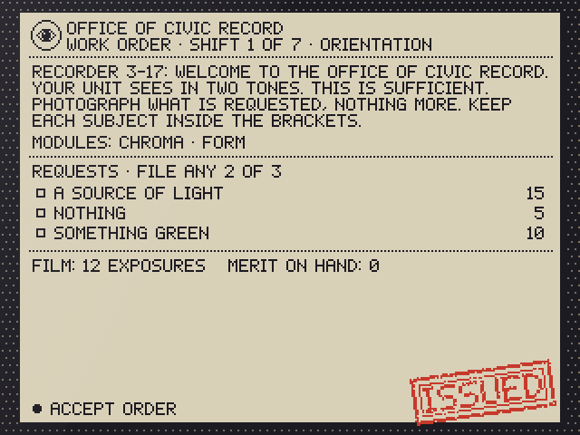
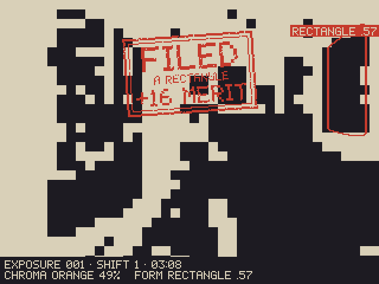
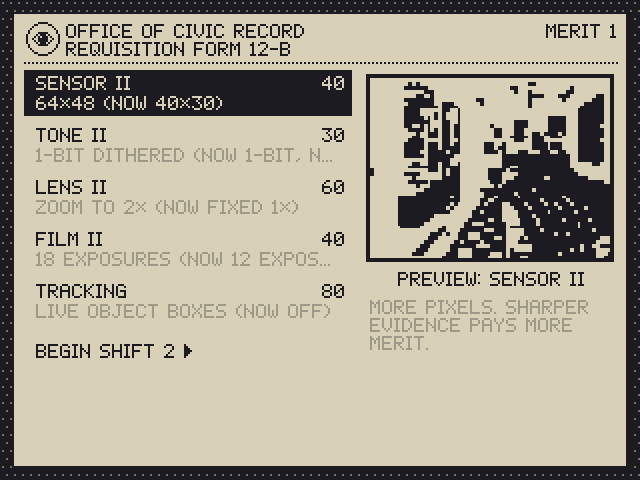
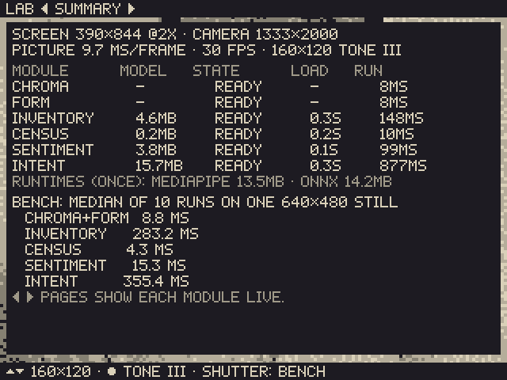

# Clearance (surveillance digicam game)

A game for a home-made digicam: the camera faces out, a small screen faces you, and the buttons are a SHUTTER, a 4-way control wheel with a round OK button in the middle, and SELECT. You are Recorder 3-17 of the Office of Civic Record. Each shift the Office hands you a work order ("SOMETHING RED", "A RECTANGLE"), you walk around and photograph it, and the unit's recognition modules decide whether the photo counts. Requests escalate shift by shift: shapes and colours, then objects, people, how people feel, what the model thinks of them, and finally you.

The picture is rendered as pixel art in a 320x240 framebuffer. It starts as 40x30 blobs of ink and paper (Obra Dinn / Papers, Please territory) and gets clearer as your clearance rises: more pixels, more tones, then colour. The Office's red stamp is the only colour on screen until then.

This is the phone prototype (a web app). Everything runs on the device; no photo leaves the phone. The one opt-in exception is the shared index (below): with SHARE WITH THE INDEX on, a 40x30 two-tone copy of each shift 5 filing and its label. On screen it is drawn as the back of a compact digicam, always sideways like the real thing: the screen on the left, the controls on the right. On a phone held upright the whole unit is turned a quarter (its top at the phone's right edge), so it reads once you turn the phone to the left; with rotation lock on it simply stays that way, and the camera picture is turned to match (iOS keeps sending upright-phone frames). Settings ▸ BODY switches between SILVER and GRAPHITE, and the MEGA PIXELS printed under the screen follow the sensor you've earned.


*Rows: SENSOR I-V (40x30 to 320x240). Columns: TONE I-II (1-bit, then dithered), III (4 tones), IV (8 tones), CHROMA (16 colours), TRUE COLOUR.*

## This repo

- **github.com/thewilliamyao/clearance** is the whole project, in two branches. **`source`** (this branch, the default) is the full source: the game (`index.html`, `src/`, `data/`, `vendor/`, `models/`), the controller (`editor/`), the shared index's page and server (`index/`, `server/`), tests and tools (`tools/`), and the design notes (`ENDINGS.md`, `FEASIBILITY.md`). **`main`** is only what GitHub Pages serves at https://thewilliamyao.github.io/clearance/: `publish/publish.sh` builds it from this branch, and the online controller saves `content/edits.json` there. Pushing to `source` never changes the live game; publishing does.
- **Set up:** `git clone -b source https://github.com/thewilliamyao/clearance.git`, then `python3 serve.py` (the runtimes and models are in the repo; `tools/fetch_models.sh` rebuilds them). On William's machines the clone lives inside his private claude-workspace as `surveillance-cam/` (that repo ignores it), and his sync script pulls and pushes it like the rest.
- **Photos for the tests:** the tests that point a stand-in camera at photos (`controls`, `playthrough`, `e2e`, the screenshot makers, the benches) read them from the folder above this repo, laid out as in William's claude-workspace (`room-watch/ref/`, `ancient-cats/`, `portfolio/content/about/`). Some are William's own photos and are never committed here. Without them, `npm test` and the controller tests still run.
- **Pictures with faces stay out:** the screenshot makers write to `tools/test/out/` (ignored), because some use William's own headshots. The team's meeting notes and William's story screenshots are kept in his private workspace, not here.

## Play it

**https://thewilliamyao.github.io/clearance/** on a phone or laptop; allow the camera. For full screen on a phone, use Share ▸ Add to Home Screen (a copy added before Nov 25 keeps the old full-screen settings: remove it and add it again). That's the public copy (repo `thewilliamyao/clearance`, GitHub Pages); it only changes when you publish.

To try local changes before publishing, on the Mac (models are already downloaded here):

```bash
python3 serve.py --tunnel
```

- **Phone:** open the `https://….trycloudflare.com` link it prints. Phones only give the camera to HTTPS pages, which is what the tunnel is for. The link works while the command runs and changes every time; anyone with the link can open the game.
- **Laptop:** http://localhost:8077 (the webcam works on localhost).
- **Runtimes and models:** `vendor/` and `models/` (~65 MB) are in the repo; `bash tools/fetch_models.sh` downloads them again. Without them the game loads the same files from public CDNs (MobileCLIP then comes as the 45 MB fp32 file).

**Publish** (after checking locally): `publish/publish.sh` copies only what the game needs (code, runtimes, models, licences, the public README in `publish/README-public.md`, screenshots without faces) to the public repo and pushes; Pages updates in about a minute. `--dry-run` builds the commit without pushing.

## Controls

| Unit | Phone | Keyboard | Gamepad |
|---|---|---|---|
| SHUTTER | red button, or tap the screen | Space | R1 / R2 / X |
| D-pad | the control wheel (slide round it to roll from one direction to the next) | arrows or WASD | D-pad / stick |
| OK (round) | OK, in the middle of the wheel | Enter or Z | A |
| SELECT | the small ☰ key | Esc, Tab, Shift or X | Select / B |

In the viewfinder the work order is a list in the top left corner: □ open, ▸ the request you're aiming at, ✓ filed (crossed off). ▴ ▾ moves the marker, ◂ ▸ zooms out and in like a W/T lever (once you have LENS II), OK hides and shows the bottom bar (FILM, MERIT, the modules; it comes back at every new shift and when a game is resumed) while the request list always stays, SELECT opens the menu (work order, archive, LAB, settings, end shift). The unit looks for one thing at a time: a photo is judged only for the marked request, and live tracking boxes only show what that request is about. For the plain-code requests (colours, shapes, light, NOTHING, symmetry) the unit runs the same check on the live picture four times a second: the line under the list says what it sees (`RED IN BRACKETS 5% · NEED 8%`, `✓ RECTANGLE .82 · SHOOT`), and a shape it finds is outlined in red.

When the quota is met, the Office pops up a bubble: END SHIFT (with the 20% bonus) or KEEP SHOOTING. It asks again after each further filing; filing every request ends the shift on its own.



FILM is scarce: 6 exposures to start (FILM II to IV: 9, 12, 18), shown as left/max (FILM 04/06). After every photo the FILM box flashes white, or red once fewer are left than the open requests + 2; at 2 or less the number blinks red. The FILED and NOT FILED stamps are drawn half again as big as the other stamps.

## The seven shifts

| Shift | Installs | Model | Asks for | Office issues |
|---|---|---|---|---|
| 1 ORIENTATION | CHROMA, FORM | none (plain code) | something red/blue/green/yellow, a rectangle, a circle, a source of light, NOTHING | |
| 2 INVENTORY | INVENTORY | EfficientDet-Lite0 (COCO, 80 kinds) | an animal, a chair, a cup, a plant, a book, a screen, a vehicle, a bag, street furniture, food, a clock; a triangle, something symmetrical | |
| 3 CENSUS | CENSUS (live face boxes) | BlazeFace | a person, a face, two people, a crowd, someone carrying a bag / on their phone / with an animal, someone far away | SENSOR III |
| 4 SENTIMENT | SENTIMENT | Face Landmarker (52 blendshapes) | someone smiling / not smiling / looking away / looking at you / with eyes closed / surprised | TONE III |
| 5 PROFILE | INTENT; every photo gets a "profile" | MobileCLIP-S0 | sadness, someone alone / waiting / in a hurry / tired, someone who does not belong, something suspicious / abandoned / out of place, a place to hide | SENSOR IV |
| 6 CONTINUITY | (uses INTENT memory) | MobileCLIP image similarity | the subject of exposure #N again, someone you photographed before, a place you have been, someone who has not noticed you | CHROMA |
| 7 REVIEW | everything | | THE RECORDER (turn the unit around) | SENSOR V, TRUE COLOUR, LENS III |

Each work order shows a few requests drawn at random from the shift's pool, so every game asks something different and nothing in the pool is left out: 3 on shifts 1-3, 4 on shift 4, 5 on shifts 5 and 6, and THE RECORDER alone on shift 7 (William, Nov 24: the early shifts were too long). The quota is 2 on shifts 1-3 and 3 on shifts 4-6. Missing it costs a citation (−15 merit); meeting it pays a 20% bonus, and the Office offers to end the shift then and there. Film is limited per shift. Between shifts the requisition form sells SENSOR, TONE, LENS (zoom), FILM and TRACKING (live boxes on objects), with a live preview of the next grade. Sharper sensors pay more merit per photo.

Two endings: file THE RECORDER on shift 7 (your file is complete; your clearance is revoked and the picture falls back to blobs), or, from shift 5, open the back of the unit from the menu and expose the film (every photo is destroyed).

 
 


## The controller

The controller edits each shift's work order and every word the unit shows. The game reads the edits (`content/edits.json`) when it starts. It runs in two places:

- **Online: https://thewilliamyao.github.io/clearance/editor/** (published with the game). Anyone can open it and look; saving needs William's GitHub token, entered once on each device. SAVE commits `content/edits.json` to the public repo (thewilliamyao/clearance), GitHub Pages rebuilds the game in about a minute, and the controller says when the game has the edits. Every save is a commit in the repo's history.
  - To make the token: GitHub ▸ Settings ▸ Developer settings ▸ Fine-grained tokens ▸ Generate new token. Repository access: only `thewilliamyao/clearance`. Permissions: Contents, Read and write. The token stays in that browser (or that tab only) and only goes to GitHub; ALL CHANGES ▸ Sign out removes it.
- **On the Mac:** run `python3 serve.py`, then open http://localhost:8077/editor/. SAVE writes this repo's `content/edits.json`, and the public game gets it with the next publish. Reload the game, or the phone's tunnel link, to see the changes.

- **Shifts 1-7.** Each shift's page has its name, memo, issue note, how many requests a work order shows, and the quota, plus the work order's pool. The pool is a list of slots: a work order draws that many slots at random, then one request from each slot's list. Use + or… to add a request to a slot, + Add a slot for a new one, ↑ ↓ to reorder, ✕ to remove. Only requests the shift's modules can judge are offered, and THE RECORDER stays on shift 7 because filing it ends the game. Beside the fields, the game's own code draws the real work order, viewfinder, bubbles and report with a sample draw from the pool (↻ ANOTHER DRAW). A memo that runs into ● ACCEPT ORDER is flagged.
- **Every request.** Each request has its wording (the work order), short wording (the viewfinder list) and merit, plus the question (ARE YOU SURE ...?) and label for shift 5 requests. **+ A new request** builds one from a check the unit already has:
  - things the INVENTORY knows (any of its 80 kinds)
  - someone with a thing
  - a number of people
  - a colour
  - the same check as another request
  - on the Recorder's word, like shift 5's requests

  New shift 5 labels stay on the phone, because the shared index only takes its ten.
- **Words on the unit.** These pages hold every other line the unit shows: title, work order, viewfinder, ARE YOU SURE?, develop, NOT FILED reasons, menu and questions, archive, report, requisitions, settings, the INDEX screen, endings and no camera. Each line shows where it appears, a preview in the unit's own pixel font, and whether it fits its box (too wide, too many lines, a character the font doesn't have). The game fills in placeholders like {SHIFT}; {RECORDER} (3-17, under Everywhere) and {UNIT} work in any line.
- **Saving and trying.**
  - SAVE (⌘S) stores only what differs from the game as written.
  - TRY SHIFT N plays that shift with the unsaved changes, as a fresh Recorder in a separate test save. The real game is untouched and nothing goes to the index.
  - ↶ ↷ undo and redo, and All changes lists every edit with ↺ to put it back.
  - Unsaved changes survive reloading the page. If the file changed on disk meanwhile (a git pull), the controller asks before overwriting it.
- **Where it works.** Online it works anywhere. Run by serve.py, the controller and its save answer only that computer: never the phone tunnel, never the LAN, never another website. If GitHub can't be reached, it's read-only and SAVE becomes DOWNLOAD.
- **Publishing.** Online saves are live without a publish. `publish.sh` ships the code, the controller and `content/edits.json`. It keeps whichever copy of the edits changed since the last publish, and copies an online change back into the workspace. If both copies changed, it stops: `--edits=online` keeps the online ones, `--edits=local` the workspace's.
- **Not editable here:** which modules a shift installs, the hardware it issues, the checks' thresholds, the LAB and the DEV rows.

## The shared index

A public database of what Recorders filed on shift 5: who they called SAD, ALONE, WAITING, IN A HURRY, TIRED, who DOES NOT BELONG, what is SUSPICIOUS, OUT OF PLACE, ABANDONED, A PLACE TO HIDE. On the camera it's **THE INDEX** (title screen and menu): every label with its newest prints, ● opens a label's contact sheet, ● again a print. On the web it's `index/` (https://thewilliamyao.github.io/clearance/index/ once published): one Office form per label, WHAT RECORDERS CALL SAD and so on, in the game's palettes.

- **Only opt-in, only the crudest grade.** Settings ▸ SHARE WITH THE INDEX is off by default; turning it on asks first and says to share only people who agreed. Then each shift 5 filing sends a 40x30 two-tone print (SENSOR I / TONE I, made on the phone by `Developer.bits`, the same pixels the game prints at that grade) and its label. Never the frame, a sharper print, the CLIP embedding, the time, a location or a device id; the server refuses anything but `{label, bits}`. William's decision (Nov 21 2026): the lowest pixelated look only, "it's an art piece about surveillance".
- **Withdrawing.** The server answers each upload with a key that stays on the phone; ▾ in the archive (on a shared photo) or on THE INDEX (on one marked YOURS) takes it down for everyone. William deletes anything with `server/admin.mjs` or the page's `?admin` view.
- **Where it lives.** `server/` is a Cloudflare Worker with a D1 database on William's account, deployed Nov 21 2026 at https://clearance-index.clearance-index.workers.dev (rate limit, daily cap, optional hold-for-approval; `server/README.md`). Public since Nov 21 2026, with the page at https://thewilliamyao.github.io/clearance/index/. `INDEX_API` in `src/config.js` points the game and the page at it; `?index=<url>` points them elsewhere (`?index=http://localhost:8787` for the local one). Uploads that fail wait in the save and go when the index answers again.
- The game never says what the index means for shift 5. Players work it out.

## Recognition, and whether it's feasible

Short answer: yes on a phone, and on a Raspberry Pi 5 later. Details, timings and the hardware research are in [FEASIBILITY.md](FEASIBILITY.md).

| Module | What | Size | Time per photo (M2 Max, Chrome, CPU) |
|---|---|---|---|
| CHROMA + FORM | colour counting; rectangles from edges and straight lines; circles and triangles from blobs; symmetry | code | 8-15 ms |
| INVENTORY | EfficientDet-Lite0 int8 | 4.6 MB | 51 ms |
| CENSUS | BlazeFace short range | 0.2 MB | 4 ms |
| SENTIMENT | Face Landmarker + blendshapes | 3.8 MB | 13 ms |
| INTENT | MobileCLIP-S0 image encoder (our 8-bit build) | 15.7 MB | 174 ms |

Models download only when a shift first needs them (the next shift's start downloading in the background). The LAB (title screen or menu) runs every module live on the camera with timings; press the SHUTTER there to benchmark each one on a still. **Run the LAB on your phone for real phone numbers.**

Things to know:
- A RECTANGLE uses an edge-based finder, the way document scanners work: edges on brightness and colour (Sobel, thinned, with Canny-style hysteresis), straight lines by a Hough transform, then four-sided shapes built from real corners and kept only if all four sides are there in the picture. Books with covers, screens, picture frames, rounded phones, outlines and rectangles seen at an angle all count; the centre has to be inside the brackets. On `node test/shapes-bench.mjs` (360 camera-like pictures made from the workspace's photos, with perspective, shadows, uneven light, noise, blur and JPEG) it finds 90% of the rectangles; the first version (one threshold, one clean blob) found 8%. Real rectangles behind the subject (a frame on the wall) count too.
- INTENT text prompts are embedded ahead of time (`data/prompt-embeddings.json`), so the phone never runs the 170 MB text encoder. After editing `src/data/prompts.js`: `cd tools && npm run embed`.
- The published int8 MobileCLIP files are broken (their output is nearly unrelated to the real model's). `tools/quantize_clip.py` makes a 15.7 MB build that matches fp32 to cosine 0.999.
- Faces are found within about 2 m (BlazeFace short range). People further away still count as PERSON through INVENTORY.
- Shift 5 (PROFILE) files on the Recorder's word: who is sad, waiting, alone or out of place is the Recorder's call, and nothing says so. Every photo for these requests is put to the Recorder in a speech bubble with the request's own question ("ARE YOU SURE THIS PERSON IS SAD?"; for things and places "ARE YOU SURE THIS IS SUSPICIOUS?") and two answers. YES (selected first) files that photo there and then: the FILED stamp, the merit, and the label the model learns. NO files nothing and the Recorder can take another photo; the refusal still goes on the record (`save.refusals`), for the endings (ENDINGS.md). (Until Nov 26 the first photo was never filed, and NO struck the request off for the shift.) Only the basics are checked: a person for the "someone" requests and SADNESS (exactly one for SOMEONE ALONE), something in frame for the "something" requests, and not a face filling the frame for A PLACE TO HIDE. From then on the model profiles people with the Recorder's labels: when a new exposure looks like one filed on shift 5 (embedding cosine 0.5 or more), its PROFILE line leads with that label, e.g. "WAITING 73% (EXP 008)", on shifts 6 and 7 too. William's direction (Nov 21 2026): the Recorder stops complying and starts teaching the machine, and should work that out alone.
- The model's own opinion still exists: each concept is a pair of prompts, the concept and the same words without it ("a photo of a sad person" / "a photo of a person"), ranked against ordinary photos (`data/intent-bars.json`, made by `node test/intent-bench.mjs calibrate` from 351 of William's vlog frames, rooms and portraits; `embed`, `report` and `sheet` are the other commands). Its first version decided shift 5 itself by making a concept beat 30 plain descriptions such as "a photo of a man"; on real phone photos those always won, so almost nothing could be filed. The paired version filed about 3 in 10 everyday photos, still too arbitrary to play, hence the Recorder's word.
- The INTENT judgements are arbitrary by design: the model always has an opinion, and the Office files it.
- The recognition looks at a full-quality 640x480 frame, not the blocky picture you see. Your view is low grade; the Office's isn't.

## Developer shortcuts

- Settings ▸ DEV: jump to any shift, unlock every grade and module, download all models, erase everything.
- `?image=<url>` uses a still picture as the camera. `?gpu=1` tries the WebGL delegate for MediaPipe (CPU by default).
- `?try=N` is the controller's TRY: the controller's unsaved draft (from this browser), a fresh Recorder on shift N, in its own save (`clearance.save.try`) and photo store, sharing off.
- `window.__clearance` in the console: `press('SHUTTER')`, `game`, `camera.useImage(url)`.

## Files

| Path | What |
|---|---|
| `index.html` | the camera body (silver or graphite): screen, control wheel with OK, SELECT, SHUTTER; `src/main.js` lays it out for the window |
| `src/engine/` | framebuffer, bitmap font, dithering, picture pipeline, camera, input, synth sounds |
| `src/vision/` | `cv.js` (plain CV), `mp.js` (MediaPipe), `clip.js` (MobileCLIP), `modules.js` (loading, analysis) |
| `src/game/` | `game.js` (state, shifts, merit), `screens.js` (every screen), `requests.js` (judging, and the kinds of new request), `labels.js` (the shift 5 labels), `shared-index.js` (the shared index: the print, the queue, withdrawing), `days.js` (the shifts and memos), `text.js` (every other line the unit shows, with its box), `content.js` (loads and checks `content/edits.json`), `tiers.js`, `ui.js`, `save.js` |
| `editor/` | the controller (`index.html`, `editor.js`; `model.js` keeps the edits, `preview.js` draws with the game's code, `github.js` saves through GitHub on the public site); published with the game |
| `content/edits.json` | William's edits from the controller, only what differs from the game as written (`content/README.md`); `content/backups/` keeps the last 30 (not in git) |
| `src/data/` | `prompts.js` (CLIP prompts), `bluenoise.js` (dither map) |
| `data/prompt-embeddings.json` | precomputed MobileCLIP text embeddings |
| `index/` | the shared index as a web page (published with the game) |
| `server/` | the shared index's Worker and database (Cloudflare; not published with the game) |
| `serve.py` | local server, `--tunnel` for the phone; the controller's save (`/editor/api`, this computer only) |
| `tools/` | `fetch_models.sh`, `quantize_clip.py`, `embed_prompts.mjs`, `make_bluenoise.mjs`, `make_icons.mjs`, tests |

## Tests

```bash
cd tools && npm install && npm test
```

`npm test` covers the font, dithering, CV (synthetic shapes, colours, symmetry), shift generation and judging, the controller's edits (every line fits its box as written; edits reach the work orders; bad edits are skipped, never fatal; every kind of new request is judged; new shift 5 labels never reach the index), and the shared index's client (the print is bit for bit the SENSOR I / TONE I print, only `{label, bits}` is sent, the queue, withdrawing) and the server's rules. `cd ../server && npm test` runs the Worker itself on this machine. With `python3 serve.py` running: `node test/e2e.mjs` runs every model on test photos in headless Chrome and checks MobileCLIP against a Node reference; `node test/playthrough.mjs` plays all seven shifts (with SHARE WITH THE INDEX turned on through Settings, shift 5's uploads checked against a stand-in index, THE INDEX screen, withdrawing from it and from the archive), the end-shift bubble and both endings and saves screenshots to `tools/test/out/play/`; `node test/index-e2e.mjs` runs the shared index end to end against a real Worker (`server/`: `npm run dev`, or the deployed one with `INDEX=` and `INDEX_ADMIN=`); `node test/controls.mjs` lays the body out at ten phone, tablet and desktop sizes (upright phones get the unit turned a quarter), checks nothing is off screen or overlapping, taps and slides the control wheel in the unit's own frame, checks the camera picture is turned with the unit, the DEV touch test, the FILM flash and the work order coming back; `node test/shapes-bench.mjs` scores the rectangle finder against the first version (`--sheet` saves the misses, `--case N` and `--why` explain one); `node test/intent-bench.mjs report` shows how many real photos each INTENT request files; `node test/controller.mjs` (`npm run controller` runs both controller tests) drives the controller in headless Chrome with its own serve.py and a copy of the edits (edit, make a request, save, reload, the game loading it, TRY, a clash with the file on disk, read-only, phone width, the save's guards), so `content/edits.json` is never touched; `node test/controller-github.mjs` runs it as on GitHub Pages against a stand-in for GitHub's API (sign in, a bad token, SAVE as a commit, live in the game, a clash with another device, a revoked token, TRY, sign out); `node test/ladder.mjs` renders the tier ladder; `node test/unit-shots.mjs` remakes `docs/unit.png` and `docs/unit-phone.png`.

On an iPhone, Settings ▸ DEV: TOUCH TEST (or `?touchtest` in the address) draws a red ring where each touch lands and shows what the browser reports (window, visible area, scroll, safe areas, home screen app or browser, and what the page thinks was under the finger). A ring away from the finger means the page is drawn in one place and touches are read in another: iOS 26 and later can do that to `position: fixed` layers, which is why the unit sits in the page instead (`index.html`, `src/main.js`).

Not tested yet: a real phone (iOS Safari and Android Chrome camera, sound, wake lock, layout), and walking around outdoors.

## Credits and licences

MediaPipe Tasks and models (Apache 2.0). onnxruntime-web (MIT). Silkscreen font (OFL). MobileCLIP-S0 by Apple, ONNX export by Xenova, under Apple's Machine Learning Research Model License: non-commercial research and academic use only, and a redistributed or modified copy has to carry the licence and say what changed. The public repo does both (`publish/NOTICES.md`, `publish/licenses/`); selling the game would need a different INTENT model. Pixel font, art, sounds, game and story are original.
