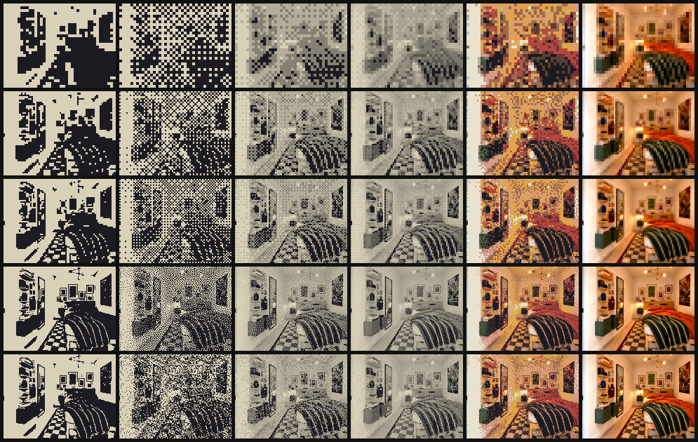
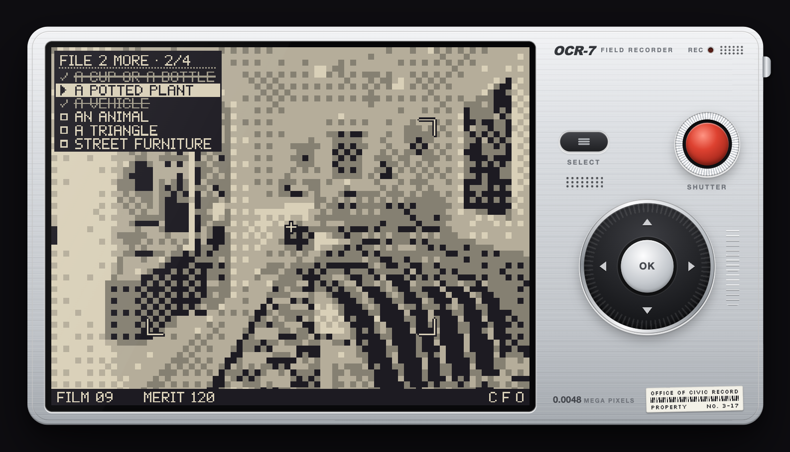

# Clearance

**Play it: https://thewilliamyao.github.io/clearance/** (on a phone or a laptop; allow the camera)

A game for a home-made digicam, prototyped as a web app. The camera faces out, the screen faces you, and the buttons are a SHUTTER, a 4-way control wheel with a round OK button in the middle, and SELECT. You are Recorder 3-17 of the Office of Civic Record. Each shift the Office hands you a work order, you walk around and photograph what it asks for, and the unit's recognition modules decide whether the photo counts. The requests escalate over seven shifts: colours and shapes, then objects, people, how people feel, what the model thinks of them, and finally you.

The picture starts as 40x30 blobs of ink and paper and gets clearer as your clearance rises: more pixels, more tones, then colour.

## Privacy

Everything runs in your browser. The camera picture, your photos and the model's judgements never leave the device. Progress and photos are kept in the browser's storage; Settings ▸ ERASE EVERYTHING deletes them.

## Controls

| Unit | Phone | Keyboard |
|---|---|---|
| SHUTTER | red button, or tap the screen | Space |
| D-pad | the control wheel | arrows or WASD |
| OK | OK, in the middle of the wheel | Enter or Z |
| SELECT | the small ☰ key | Esc or Tab |

In the viewfinder the work order is a list in the top left corner. ▴ ▾ picks the request you're aiming at (a photo is judged only for that one), ◂ ▸ zooms once you've earned the lens, and SELECT opens the menu. For colours and shapes the unit shows live what it sees: a reading under the list, and a red outline around a shape it has found. When the quota is met the Office offers to end the shift. Hold the phone sideways for the full camera layout; on a phone, Share ▸ Add to Home Screen gives you full screen.

## How it recognises things

| Module | What it does | Model | Download |
|---|---|---|---|
| CHROMA, FORM | colour, rectangles (edges and straight lines, like a document scanner), circles, triangles, symmetry, light | none (plain code) | 0 |
| INVENTORY | 80 kinds of object | EfficientDet-Lite0 int8 (MediaPipe) | 4.6 MB |
| CENSUS | faces, tracked live | BlazeFace (MediaPipe) | 0.2 MB |
| SENTIMENT | expressions and head turn | Face Landmarker, 52 blendshapes (MediaPipe) | 3.8 MB |
| INTENT | profiles: abstract ideas ("sadness", "someone who does not belong") | MobileCLIP-S0 image encoder (Apple), zero-shot against precomputed text embeddings (pairs of prompts, ranked against ordinary photos), plus image similarity | 15.7 MB |

Models download the first time a shift needs them. The LAB screen (on the title screen and in the menu) runs every module live on the camera and benchmarks them on your device.

## About

Made by William Yao. Prototype: it has been tested in desktop Chrome and phone emulation, not yet on many real phones.

This repository is the published copy of the game. It is updated from William's working folder by a publish script, so changes made here directly will be overwritten.

Third-party runtimes and models, and their licences, are listed in [NOTICES.md](NOTICES.md). MobileCLIP is under Apple's Machine Learning Research Model License (non-commercial research use only); the copy here is a modified, smaller build, described in NOTICES.md.
